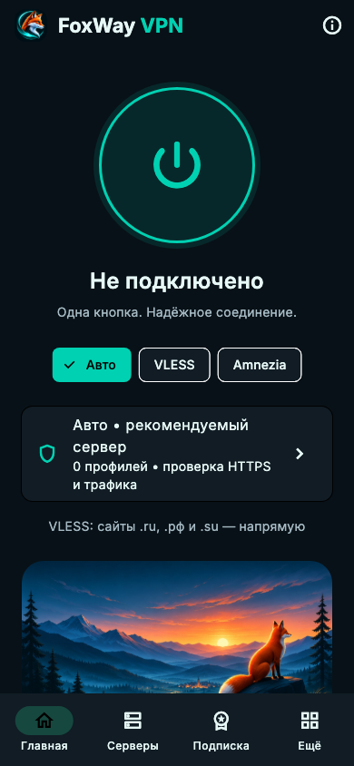
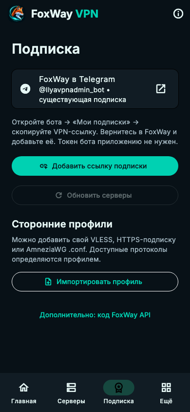

<div align="center">
  
  <h1>FoxWay VPN</h1>
  <p><strong>Одна кнопка. Свой маршрут.</strong></p>
  <p>AmneziaWG · VLESS / Reality · Flutter · пять платформ</p>
  <p>
    <a href="https://github.com/starscream001/vpn_app/actions/workflows/build.yml"></a>
    <a href="https://github.com/starscream001/vpn_app/releases"></a>
    <a href="docs/LICENSES.md"></a>
  </p>
  <p>
    <a href="https://github.com/starscream001/vpn_app/releases"><strong>Скачать</strong></a> ·
    <a href="#быстрый-старт">Начать пользоваться</a> ·
    <a href="docs/MECHANICS.md">Как всё работает</a> ·
    <a href="docs/VALIDATION.md">Результаты проверок</a>
  </p>
</div>

<br>

<div align="center">
  
  &nbsp;&nbsp;
  
</div>

<br>

> **Предварительная версия.** Реальные подключения и отказоустойчивость на устройствах ещё требуют изолированного стенда. Apple-сборки не подписаны для установки. Успешный тест конфигурации или сборка не заменяет проверку VPN и утечек.

## Главное

| | Возможность |
|---|---|
| **Подключение** | Авто / VLESS / Amnezia, ограниченный выбор кандидатов, HTTPS-проверка и счётчики трафика |
| **Ваши профили** | VLESS TCP Reality/TLS, AmneziaWG `.conf`, plain/base64 HTTPS-подписки |
| **Ваш бот** | [@Ilyavpnadmin_bot](https://t.me/Ilyavpnadmin_bot) → существующая ссылка подписки → FoxWay; обновление списка каждые 15 минут |
| **Раздельный трафик** | Домены `.ru`, `.рф`, `.su` и ручные домены напрямую в VLESS; приложения — на Android |
| **Защита при обрыве** | Системная блокировка Android, Network Extension на Apple, отдельные WFP / nftables / PF правила desktop |
| **Новые версии** | Автопроверка раз в 6 часов, проверка SHA-256, Android installer, установка Windows/Linux с предыдущим bundle для отката |
| **Данные** | Профили, ссылки и настройки в OS secure storage; обновление приложения не очищает vault |
| **Качество** | Отчёты только по согласию и при настроенном API; без ключей, сайтов и списка приложений |

## Быстрый старт

1. Скачайте **полный архив своей платформы** в [Releases](https://github.com/starscream001/vpn_app/releases). Для большинства Android-телефонов нужен `app-arm64-v8a-release.apk`.
2. Откройте **Подписка → FoxWay в Telegram**. В боте выберите «Мои подписки» и скопируйте свою постоянную VPN-ссылку.
3. Вернитесь в FoxWay → **Добавить ссылку подписки** → вставьте HTTPS-ссылку → **Добавить**. Приложение загрузит совместимые серверы, покажет их число и срок действия (если провайдер его передаёт), сохранит подписку и будет обновлять её каждые 15 минут, пока работает. Можно также импортировать независимый профиль.

Если ссылка не принимается, приложение объяснит причину. Поддерживаются безопасные HTTPS-перенаправления, plain/base64 и base64 с переносами строк. [Как работает импорт и что проверено](docs/SUBSCRIPTIONS.md).
4. Разрешите VPN и нажмите кнопку подключения. Авто рассматривает до четырёх подходящих профилей.
5. Килл-свитч включается отдельно в **Ещё**. При нём исключения временно не действуют: пользовательский трафик идёт через VPN. На Android дополнительно включите системную блокировку.

Совместимые профили из смешанной подписки импортируются отдельно; число пропущенных видно в приложении. WS/gRPC/XHTTP, Hysteria2, QR и `vpn://` пока не поддержаны. Подробности: [сценарии и ограничения](docs/MECHANICS.md).

## Платформы

| Платформа | Движки | Защита при обрыве | Установка обновления |
|---|---|---|---|
| Android 8+ | AWG Android + Xray | Always-on / Block without VPN; проверка политики Android 10+ | Системный APK installer, сверка package/version/signature |
| iOS 15+ | Два Packet Tunnel расширения: libbox и AWG | IncludeAllNetworks + On Demand, с системными исключениями Apple | App Store / TestFlight после настройки подписанного выпуска |
| Windows x64 | sing-box + AWG service | Постоянные WFP filters, сохраняются после закрытия core/GUI | Подтверждение → новый bundle → перезапуск; предыдущий сохранён |
| Linux x64 | sing-box + AWG Go/tools | Собственная nftables table, IPv4/IPv6, без established-bypass | Подтверждение → атомарная замена bundle → перезапуск |
| macOS | sing-box Intel/Apple Silicon + AWG NE | PF для VLESS; Network Extension для AWG | Проверенный архив; автоустановка ждёт подписанного канала |

**Права:** Windows запрашивает UAC. Linux требует nftables, Python 3, polkit/pkexec; AWG также iproute2/resolvconf/iptables либо nftables. VLESS core нужен NET_ADMIN/NET_RAW или административный запуск. macOS VLESS/PF нужны повышенные права, Apple NE — подпись и provisioning. Это bundles, не production установщики.

**Строгий режим:** защита применяется при подключении. Неудачная проверка или автоматическая смена сервера не снимает desktop firewall. Явное отключение снимает собственные правила. На Android системную блокировку отключает пользователь в настройках ОС. На Apple строгий режим удерживает текущий сервер, вместо небезопасного переключения между расширениями. [Механика и восстановление доступа](docs/PROTECTION.md).

## Обновления и подпись

Приложение проверяет GitHub Releases при запуске и каждые 6 часов. Скачанный файл доступен установщику только после сверки SHA-256. Windows/Linux ещё раз проверяют архив, запрещают traversal/symlinks и готовят bundle до закрытия приложения. Vault не входит в заменяемый каталог.

Для Android обновления нужны одинаковые signing keys и увеличенный build number. CI умеет использовать production keystore из GitHub Secrets. Preview-key временный; private keys не помещаются в CI cache. Для надёжных обновлений нужен постоянный production keystore. Переход с старой тестовой подписи 0.2 может быть несовместим: FoxWay откажет в установке, а не удалит данные.

[Настройка каналов, подписи и отката →](docs/UPDATES.md)

## Разработка

```sh
flutter pub get --enforce-lockfile
flutter analyze
flutter test --coverage
python3 -m unittest discover -s backend -v
```

Flutter **3.47.9**, Java **21**, Android SDK **36**, NDK **28.2.13676358**, Go **1.26** для AWG. Apple-сборки требуют полного Xcode. Версии и native build steps закреплены в [GitHub Actions](.github/workflows/build.yml); исходники ядер собираются отдельно в corresponding-source archive.

Рабочие серверы, платёжная система и действующий Telegram poller этим приложением не изменяются. Существующий бот подключён через уже выдаваемые HTTPS-ссылки. Новый bearer API и collector — отдельный, пока не развёрнутый канал интеграции; их нельзя считать подключёнными только по наличию кода.

[Проверенный прогон 0.3: все 7 jobs успешны](https://github.com/starscream001/vpn_app/actions/runs/42800991614) — 49 Flutter + 16 Python tests, native routing checks и сборки всех платформ. [Точные результаты и ограничения](docs/VALIDATION.md).

## Документация

| Пользователю и владельцу | Разработчику |
|---|---|
| [Путь пользователя, выдача и продление](docs/MECHANICS.md) | [Архитектура](docs/ARCHITECTURE.md) |
| [Килл-свитч и восстановление сети](docs/PROTECTION.md) | [API и отчёты качества](docs/API.md) |
| [Обновления приложения](docs/UPDATES.md) | [Native движки и права](docs/NATIVE_VPN.md) |
| [Что проверено](docs/VALIDATION.md) | [Подпись iOS/macOS](docs/IOS.md) |
| [Релизы](https://github.com/starscream001/vpn_app/releases) | [Лицензии](docs/LICENSES.md) · [Corresponding sources](docs/SOURCES.md) |

---

<div align="center">
  <strong>FoxWay VPN</strong><br>
  Рыжая лиса · тёмные горы · бирюзовый свет
</div>
