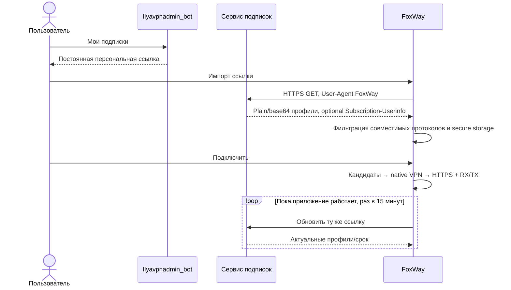

# Как работает FoxWay

## Действующий бот и подписки

Из истории проекта восстановлены @Ilyavpnadmin_bot и постоянные ссылки вида `https://sub.ilyamanik.ru/s/<token>`. У действующего бота уже есть владельцы, привязки Telegram, несколько подписок на владельца, даты окончания и запросы продления. FoxWay использует существующий канал выдачи; второй Telegram poller, отдельные платежи и новые VPN-ключи не создаются. Изменять источники синхронизированного проекта или рабочие серверы для импорта в приложение не нужно.

**Первый запуск.** Пользователь открывает бота из вкладки «Подписка», копирует свою ссылку и импортирует её. Токен ссылки — секрет доступа: приложение хранит её в защищённом vault и не показывает целиком в списке. Локальный файл AWG и независимые VLESS-ссылки также работают без бота.

**Уже есть подписка.** Выданная ссылка остаётся прежней. После импорта FoxWay автоматически обновляет её каждые 15 минут, пока приложение работает; есть ручная кнопка обновления. Таймер Dart не гарантируется во сне или при выгруженном приложении. При сетевой ошибке кеш не стирается. Последний успех и задержка совпадающего профиля сохраняются. Профили разных источников имеют раздельные ID.

**Смешанный каталог.** Импортируются VLESS TCP Reality/TLS и raw AWG `.conf`. Hysteria2/Trojan/WS/gRPC/XHTTP и повреждённые ссылки пропускаются, количество видно в UI. Если совместимых профилей нет, импорт заканчивается ошибкой и старые данные остаются. Это не добавляет поддержку пропущенных протоколов.

**Срок.** Если сервис присылает `Subscription-Userinfo: ...; expire=<unix seconds>`, дата применяется к профилям источника, в том числе оставшимся из прошлого обновления. При её достижении клиент исключает профиль и отключает активный на очередной проверке. Если сервер не передаёт дату, FoxWay её не выдумывает: срок и отзыв обеспечиваются действующей серверной системой. Персональные ссылки и ключи в публичные отчёты/README не включаются.

**Каталог сократился.** Исчезновение строки не считается автоматическим отзывом: последний рабочий профиль сохраняется до срока либо явного отзыва через v1 API. Это полезно при неполном обновлении, но не заменяет серверную блокировку отозванного ключа. HTTP-ошибка выдачи не доказывает отзыв.

## Выдача, продление и отзыв

1. Администратор выдаёт доступ в существующем боте; владелец получает свою постоянную ссылку. Новую «бесплатную» подписку приложение не создаёт.
2. Пользователь выбирает подписку и период продления в боте. Действующий процесс подтверждения оплаты остаётся источником истины. Открытие Telegram или нажатие кнопки не означает оплату.
3. После подтверждения бот обновляет срок/состояние в своей базе и на VPN endpoints. FoxWay узнаёт изменение при обновлении той же ссылки. Перевыпускать ссылку при каждом продлении не нужно.
4. При отзыве бот обязан блокировать сами VPN-учётные данные. Очистка кеша клиента не является механизмом отзыва.
5. При переносе сервера обновляется содержимое подписки, а не публичный token URL. В UI остаются профили с историей успешных проверок; новая конфигурация имеет другой hash ID.
6. При смене владельца или утечке ссылки оператор перевыпускает доступ и отзывает старый. Приложение не должно самостоятельно «исправлять» чужие подписки.

**AWG:** клиент умеет raw `.conf` с S/H/I. Действующий сервис выдачи должен действительно вернуть такой профиль. Добавление клиента не создаёт AWG peers на серверах и не делает Happ совместимым с AWG.

## Подключение и качество

Авто ранжирует пригодные профили с учётом последних успехов и задержки; в одной попытке рассматривается не более четырёх. Установленный TUN или успешный ping ещё не означают рабочий VPN. Клиент проверяет native state, HTTPS 204 и рост RX/TX; VLESS-проба принудительно направлена в proxy inbound перед любыми direct rules. На AWG произвольные AllowedIPs ограничивают доказательность HTTPS+счётчиков: нужен тестовый стенд.

Проверка — раз в 30 секунд, пока работает приложение. После трёх сбоев и двух минут с последнего переключения Авто пытается другой профиль. В строгом desktop режиме firewall остаётся включённым между попытками. На Apple строгий режим удерживает текущее расширение/сервер и доверяет системному On Demand; небезопасное переключение между расширениями автоматически не выполняется. Явное отключение пользователем — отдельное действие.

## Приватность отчётов

Существующая подписка бота и новый `/v1` collector — разные каналы. Наличие персональной ссылки не является авторизацией для collector. Пока v1 API не развёрнут и не привязан одноразовым кодом, данные на него не отправляются. Профили URL-подписок не помечаются автоматически как принадлежащие FoxWay API.

При включённом согласии и настроенном v1 API отправляются только восемь полей: opaque profile ID, протокол, результат, задержка, RX/TX delta, категория результата и время. Нет URI профиля, токена ссылки, ключей, посещённых доменов, адресов серверов или списка установленных приложений. Очередь зашифрована, максимум 100 событий, пакет 20; ошибка оставляет события для следующей попытки. Выключение согласия очищает очередь. Сервер хранит события 7 дней и ограничивает частоту.

Чтобы подключить этот collector к действующему боту, нужен отдельный изолированный HTTPS сервис, проверка владения через уже существующую customer↔Telegram привязку, выдача одноразового кода и маппинг opaque IDs. Не запускать второй getUpdates для того же bot token. Контракт и reference backend: [API](API.md). Эта часть **не развёрнута**; существующий бот работает без изменений.

## Обновления приложения и восстановление

[Полный путь обновления](UPDATES.md): проверка версии → проверка происхождения/суммы → подтверждение → штатная установка. Настройки лежат вне bundle. Отказ от обновления не блокирует VPN и не очищает данные. Нужна та же подпись/app ID; смена ключа не считается нормальным обновлением.

[Килл-свитч](PROTECTION.md): при аварии его правила не снимаются простым завершением GUI. Пользователь может открыть приложение и явно снять защиту; аварийные команды меняют только объекты FoxWay. На реальной машине эти команды в рамках разработки не выполнялись.
